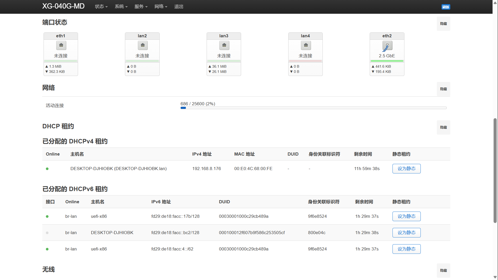
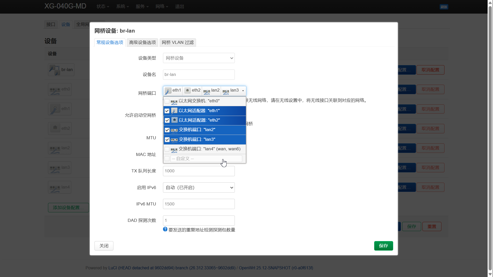
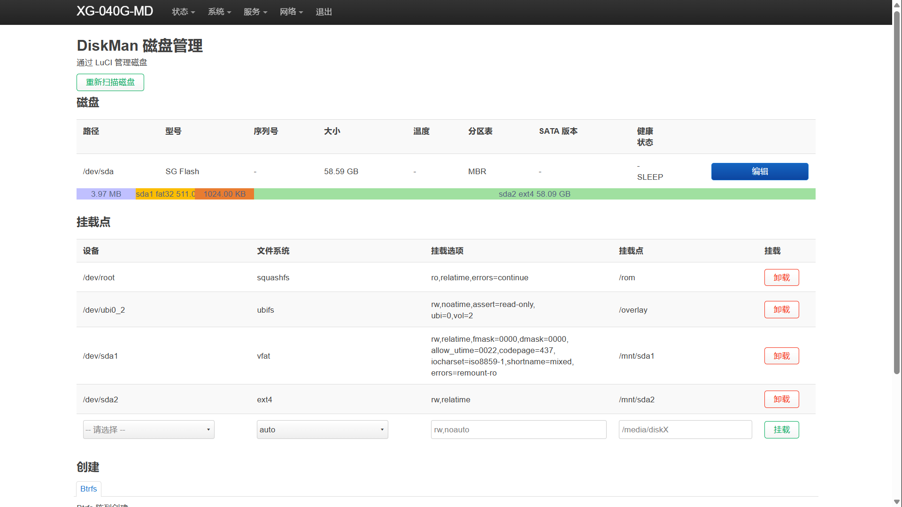

# OpenWrt for XG-040G-MD（tcboot 刷入，定制版）

NOKIA BELL XG-040G-MD 的 OpenWrt 固件，适用于已刷 **tcboot** 的机器，机型与上游 `bell_xg-040g-md` 相同。

基于 [xiangtailiang/OpenWrt-for-XG-040G-MD](https://github.com/xiangtailiang/OpenWrt-for-XG-040G-MD)，
源码 [xiangtailiang/openwrt](https://github.com/xiangtailiang/openwrt) `openwrt-25.12` 分支（内核 6.12），固定在上游固件编译时的版本。

## 特点

- 默认地址 `192.168.1.1`，账号 `root`，默认密码 `anytoolab.com`，主机名 `XG-040G-MD`，时区 Asia/Shanghai，简体中文，Bootstrap 主题
- 网口4（千兆，`lan4`）= WAN，网口1（2.5G，`eth1`）/2/3 = LAN（上游原本是 2.5G 当 WAN）；USB 2.5G 网卡（`eth2`）插上后首页「端口状态」自动出现网口图标，要当 LAN 用需在网桥设置里勾选（见下方截图）
- 加速与网络：Turbo ACC（Flow Offloading / FullCone NAT / BBR）、SQM 队列管理、定时重启
- 工具：网页终端（ttyd）、curl（含 https 根证书）、磁盘管理（diskman）
- 首页：「端口状态」显示 USB 网卡，「DHCP 租约」显示设备在线 / 离线
- LED：WAN 灯跟随连线；命令行 `ledctl off | on | status` 一键关闭 / 恢复所有灯（含网口灯，重启后保持）
- USB 硬盘 / U 盘：NTFS、exFAT、FAT32、ext4，插上自动挂载
- USB 无线：RTL8822BU、RTL8821CU、MT7612U、AIC8800D80
- USB 有线：RTL8156B 2.5G
- 换 USB 无线网卡后自动整理无线配置，「网络 → 无线」菜单随网卡出现（没插无线网卡时不显示，这是 LuCI 原生行为）
- 不带科学上网插件

## 截图

### 首页：端口状态 + DHCP 在线状态

「端口状态」最右边多出 USB 2.5G 网卡 `eth2`（显示实际速率 2.5 GbE 与流量）；
「DHCP 租约」表最前面多了一栏 **Online**，绿点 = 设备现在在线，灰点 = 有租约但已离线（依据路由器的邻居表即时判断，DHCPv4 / DHCPv6 都有）。



### USB 2.5G 网卡加入 LAN 网桥

USB 网卡插上后不会自动加入 LAN。需要到「网络 → 接口 → 设备 → br-lan → 配置」的网桥端口里勾选 `eth2`，保存并应用后，就和 `eth1`（2.5G 口）、`lan2`、`lan3` 一起组成 LAN；`lan4` 为 WAN。



### 磁盘管理（DiskMan）

「系统 → 磁盘管理」可查看 USB 硬盘 / U 盘的分区、文件系统与挂载点，支持挂载 / 卸载、分区与格式化（图中为 U 盘的 FAT32 + ext4 分区自动挂载到 `/mnt/sda1`、`/mnt/sda2`）。



## 来源与致谢

本项目 **fork 自 [xiangtailiang/OpenWrt-for-XG-040G-MD](https://github.com/xiangtailiang/OpenWrt-for-XG-040G-MD)**（MIT，Copyright (c) 2026 Freeman Wu），在其构建脚本和配置基础上做了大量修改。
OpenWrt 源码直接使用 [xiangtailiang/openwrt](https://github.com/xiangtailiang/openwrt) 的 `openwrt-25.12` 分支（固定版本，**不修改源码**，所有改动在编译时由脚本打补丁，源码补丁放在 `patches/baseline/*.patch`）。

感谢以下项目：

- [xiangtailiang/OpenWrt-for-XG-040G-MD](https://github.com/xiangtailiang/OpenWrt-for-XG-040G-MD)、[xiangtailiang/openwrt](https://github.com/xiangtailiang/openwrt)：本项目的基础
- [openwrt/openwrt](https://github.com/openwrt/openwrt)、[openwrt/luci](https://github.com/openwrt/luci)、[openwrt/packages](https://github.com/openwrt/packages)
- [radxa-pkg/aic8800](https://github.com/radxa-pkg/aic8800)（经 ImmortalWrt 整理的 AIC8800 驱动）：AIC8800D80 无线驱动
- [lisaac/luci-app-diskman](https://github.com/lisaac/luci-app-diskman)：磁盘管理
- AIC8800D80（`1111:1111`）的切换命令来自社区逆向成果（参见 [rtk94/aic8800d80-clone-dongle](https://github.com/rtk94/aic8800d80-clone-dongle)、[olamellberg/AIC8800D80](https://github.com/olamellberg/AIC8800D80)），本项目的 `aicsend` 是据此重写的小工具

## 本版相对上游的主要改动

- 首页端口状态 / DHCP 租约补丁、LED 一键开关（`ledctl`）、网口 PHY 灯的关闭与恢复
- AIC8800D80 驱动与假光盘自动切换（`aicsend` + hotplug）
- USB 无线网卡换卡自动整理、LuCI「网络 → 无线」菜单缓存刷新
- 默认时区、默认密码、主机名、网口 WAN/LAN 分配
- 编译后自动核对固件（`scripts/baseline/verify-image.sh`），避免补丁没进固件

## 刷机

### 1. 刷入 tcboot（只需一次）

参考恩山论坛教程：[XG-040G-MD 刷入 tcboot](https://www.right.com.cn/forum/forum.php?mod=viewthread&tid=8492414&highlight=XG-040G-MD)。

> 另有一份 Web U-Boot 刷机教程可供对照：[XG-040G-MD 刷机教程](https://nwrt.kuroneko.host/flashdocs/XG-040G-MD.html)。

### 2. 刷入 OpenWrt

1. 电脑网线接到设备的 LAN 口，设备**断电**
2. **开电源**，等约 **1 秒**，用针**捅一下 reset**
3. 观察前面板「**上网**」灯，**明灭 5 次**后即进入 U-Boot 网页
4. 浏览器访问 `192.168.1.1`
5. 选择要刷入的固件：Release 里的 `*-bell_xg-040g-md-squashfs-factory.bin`，上传并等待完成

以后升级可以用 `*-bell_xg-040g-md-squashfs-sysupgrade.bin`。

> [!WARNING]
> 必须**先通电，再按 reset**。**不要**先按住 reset 再通电，否则会进入底层救砖模式，进不了 U-Boot 网页。
>
> 刷机时**不要保留旧配置**，否则会沿用旧的 LAN 地址与无线设置。
> 默认 LAN 为 `192.168.1.1`，若上游路由也是 `192.168.1.x`，请先把电脑直接接到本机 LAN 口登录，再改 LAN 地址避免冲突。

## 编译

固件分两种出法，**优先用 ImageBuilder**：

| | ImageBuilder（快） | 完整编译（慢） |
|---|---|---|
| 耗时 | 几分钟 | 约 1 小时以上 |
| 脚本 | `scripts/build-ib.sh` | `scripts/build-baseline.sh` |
| 能改什么 | 软件包清单、覆盖文件（默认设置、脚本、hotplug 等） | 一切（驱动、内核、补丁、新增软件包） |
| 前提 | 一个现成的 ImageBuilder 压缩包 | 一棵 openwrt 源码树 |

### 推荐流程

1. **完整编译一次**，并在 `.config` 里打开 `CONFIG_IB=y`，编译结束会在 `bin/targets/airoha/an7581/` 下同时生成 ImageBuilder 压缩包 `openwrt-imagebuilder-airoha-an7581.Linux-x86_64.tar.zst`。它已经包含本次编出来的所有软件包（含 AIC8800 驱动）。
   （`config/xg-040g-md-baseline.config` 目前**没有**打开 `CONFIG_IB`，需要时自己加上。）
2. 之后只要**不改内核 / 驱动 / 新增 ImageBuilder 里没有的包**，就解压这个压缩包，用 ImageBuilder 反复出包：

   ```sh
   tar --zstd -xf openwrt-imagebuilder-airoha-an7581.Linux-x86_64.tar.zst
   bash scripts/build-ib.sh openwrt-imagebuilder-airoha-an7581.Linux-x86_64 out
   ```

   软件包清单在 `config/ib-packages.txt`（一行一个，`#` 开头为注释，`-包名` 表示不装），覆盖文件在 `custom/files` 与 `custom/ib-overlay`。
3. 要改驱动、内核，或新增 ImageBuilder 里没有的软件包，才重新完整编译（回到第 1 步）。

> [!NOTE]
> `build-ib.sh` 目前读取的覆盖文件（`custom/files`、`custom/ib-overlay`）**还没有包含 `baseline-final` 里新增的内容**
> （`ledctl`、hotplug、首页补丁、`init.d/led` 补丁等，这些目前是 `build-baseline.sh` 在完整编译时打进去的）。
> 想用 ImageBuilder 复现完整的 Release 固件，需要先把这些内容补进覆盖文件。

### 完整编译（本地 / VM）

需要一棵 [xiangtailiang/openwrt](https://github.com/xiangtailiang/openwrt) 的 `openwrt-25.12` 源码树（脚本不会自己克隆），默认路径 `~/work-xg040/openwrt-2512`，可用 `OPENWRT_DIR` 覆盖。

```sh
BASELINE_NO_PROXY=1 LOG_DIR=~/work-xg040/logs bash scripts/build-baseline.sh all
```

- `prepare`：重置源码到固定版本、固定 feeds、打补丁、生成 `.config`
- `build`：下载源码包、编译、**自动核对固件**
- `all`：两步一起做

编译需要 `python3`、`node`、`perl`、`unsquashfs`（核对固件用）。

编译完成后会拆开 sysupgrade 固件，用代码里的标识符逐项核对补丁、脚本、驱动是否真的进了固件（`scripts/baseline/verify-image.sh`），缺任何一项就报错。

### 云编译

Actions 页面手动触发 `Build_XG_040G_MD`（`.github/workflows/xg-040g-md-final.yml`），做法与上面的本地 / VM 流程完全相同（同样会自动核对固件），约 1 小时 40 分钟。
勾选 `publish` 会发布 Release，否则只上传 Artifacts。其余旧工作流仅作保留参考。
